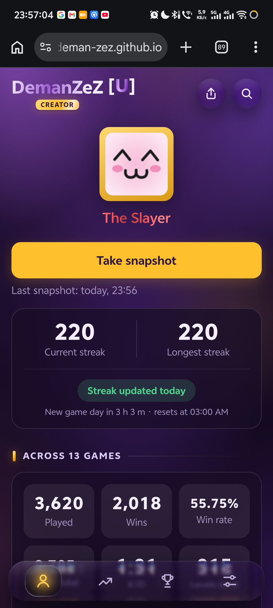
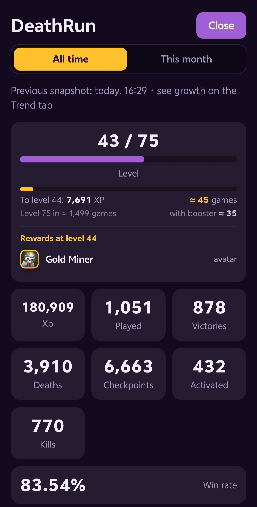
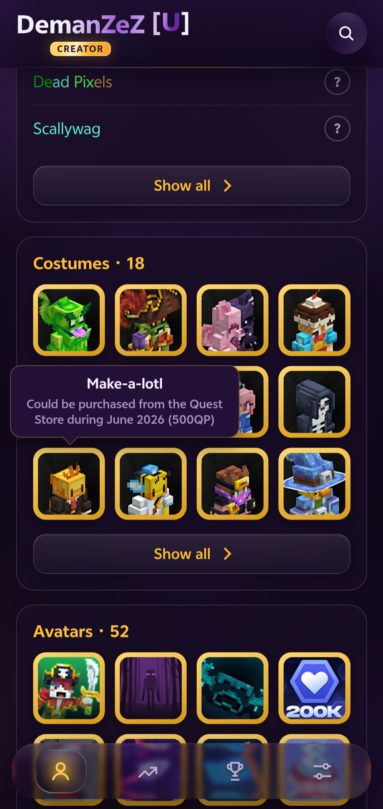
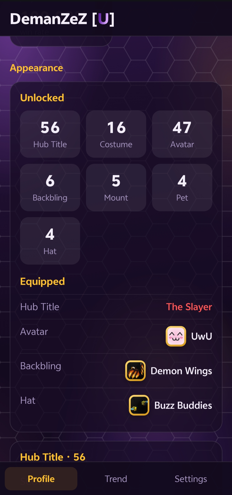
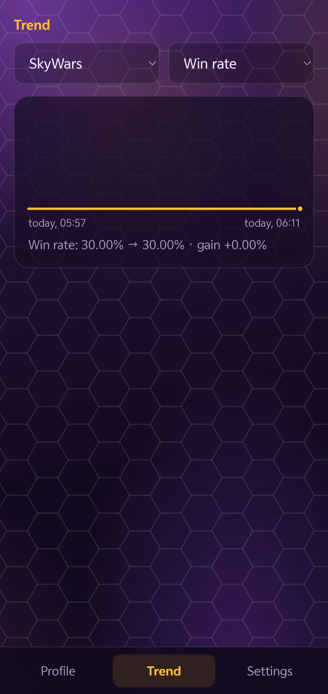
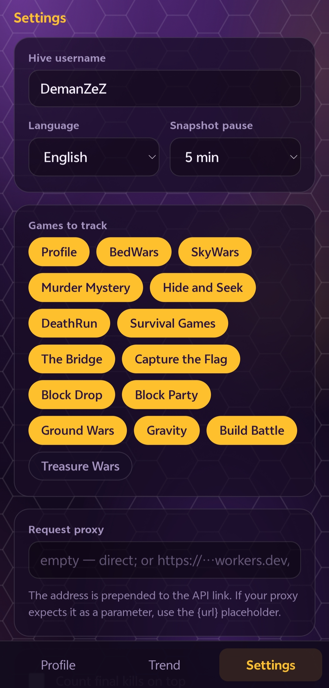
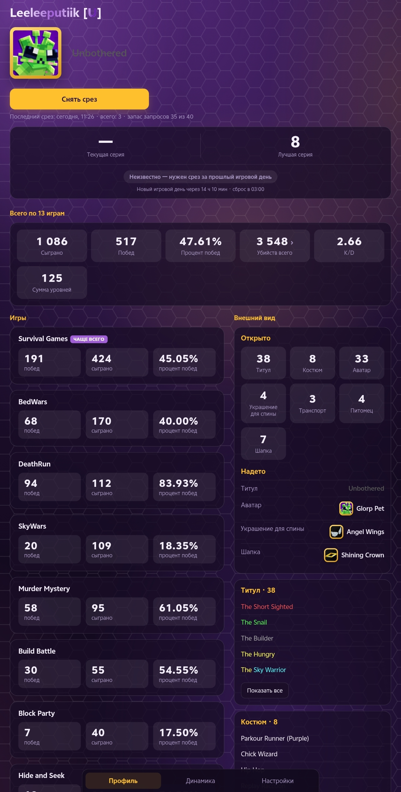

# HiveMC Profile Tracker

**Better. Beautiful. Open.** — the first open-source Hive tracker.

Stats tracker for [The Hive](https://playhive.com), the Minecraft Bedrock server. It saves snapshots of your stats over time, so you can see not just where you stand, but how fast you are moving.

**Live:** https://deman-zez.github.io/HiveMC-Profile-Tracker/

> [!NOTE]
> The project is in open beta. Found a bug or have an idea? [Open an issue](https://github.com/deman-zez/HiveMC-Profile-Tracker/issues).

## Screenshots

| Profile | Game breakdown | Cosmetics |
|---|---|---|
|  |  |  |

| Appearance | Trend | Settings |
|---|---|---|
|  |  |  |

## What it does

- **Profile** — rank, avatar, hub title in its real in-game colours, login streak and totals across all games.
- **Every game in detail** — win rate, K/D, per-game averages, level progress with an estimate of how many games the next level takes, and the rewards waiting at that level.
- **Trend** — snapshots turn into charts for any stat, including win rate and K/D, plus a summary of what changed today.
- **By month** — Hive's own numbers for each of the last twelve months, as bars for any stat. Works from the first visit, even for months when the site was never opened.
- **Recent games** — every round grouped by day with wins, losses and modes, and a calendar heatmap of the month with a detailed view of any day.
- **Leaderboards** — all-time, monthly and BedWars seasons for every mode, with search by username or place. Levels include prestige where Hive provides it.
- **Maps** — the maps currently in rotation for each mode, with a gallery you can filter by name, variant and season.
- **Compare** — put any two players side by side, for all time or for this month.
- **Share card** — a ready-made image of your profile for Discord or chats, with a link back to your page.
- **Any player** — search by username, open anyone's profile, or share a link like `?nick=DemanZeZ`.
- **English and Russian**, chosen from your device language.

On screens 900px and wider the page switches to a two-column desktop layout: games on the left, cosmetics on the right.



## Getting started

Open the site, type your Hive username and pick it from the suggestions. That's it — your profile opens and the first snapshot is taken right away.

To look up someone else, tap the search button in the profile header (or press `/` on a computer). Players you have opened recently are listed there for one-tap switching, and the **My profile** button always brings you back.

The first snapshot shows your current stats. From the second one on, the **Trend** tab starts drawing your progress, so come back after a few games.

## Your data

Snapshots are stored in your browser; there is no account to create. To use the tracker on several devices, enter the same sync code in **Settings** on each of them — your snapshots are then kept on the project's server under that code, so treat it like a password. 

Hive only shows the last ten games of a player, and only after they leave a session. So that your game history has no gaps, sign in with Xbox in **Settings**: the project's server then checks your game feed every twenty minutes and keeps what it finds, and the site merges it in when you open it. Signing in also syncs your data between devices without a code. Sign-in uses Microsoft's device-code page, and the site only receives your gamertag. Players who have not opened the site for thirty days are no longer checked.

## Limits

Hive allows each player and game to be requested three times an hour. The tracker keeps finished months for good, refreshes the current one at most every fifteen minutes, and when Hive says "too many requests" it simply waits and carries on later by itself.

## Running locally

Keep the folder structure as it is and serve it over HTTP. Opening `index.html` straight from disk often blocks browser storage, so snapshots would not be saved.

```bash
python3 -m http.server 8080
```

Then open `http://localhost:8080`.

## Credits

- [The Hive](https://playhive.com) for the server and the public API.
- [CubeEdge Studios](https://github.com/CubeEdge-Studios/hive-bedrock) for their open Hive libraries and game data.

This is a fan project, not affiliated with or endorsed by The Hive. Game names, cosmetics and images belong to their owners.

## License

MIT — see [LICENSE](LICENSE).
